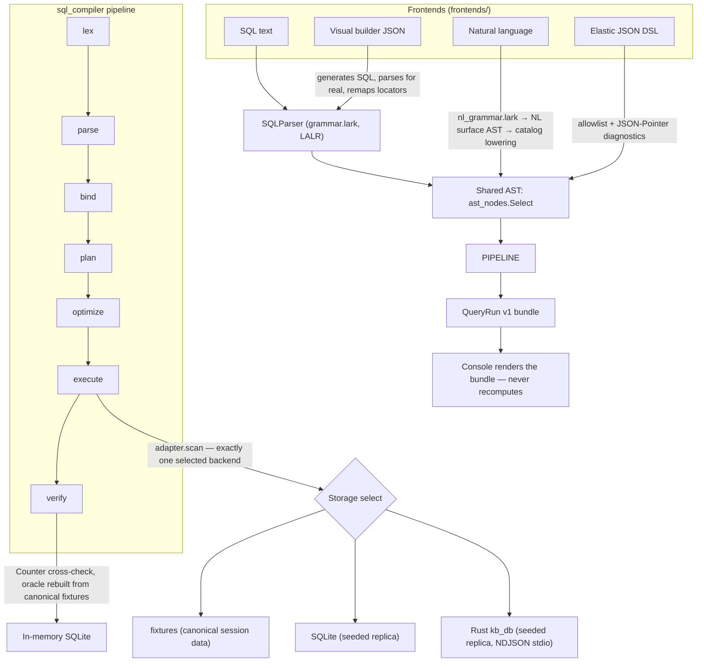
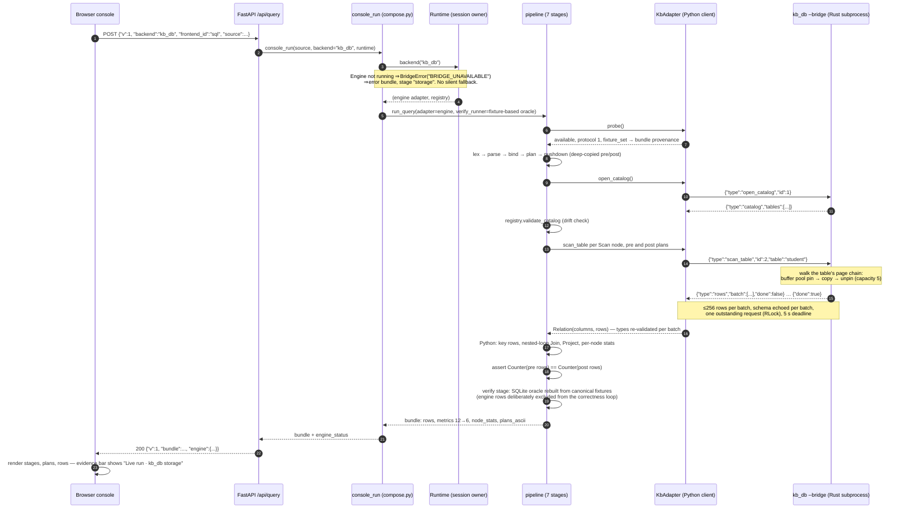
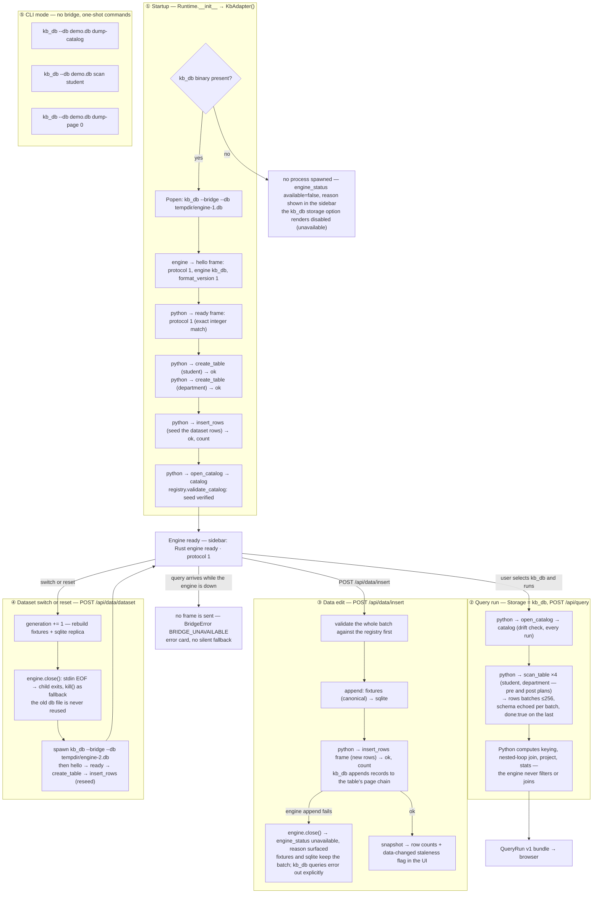

# How this project works — the full walkthrough

Status: narrative, versioned with the code. Frozen contracts live elsewhere:
`docs/adapter.md` (storage interface), `docs/protocol.md` (kb_db bridge),
`docs/bundle_schema.md` (run bundle + session data), `docs/format_v1.md`
(disk pages), `docs/nl_language.md` (NL grammar).

The whole project is one idea applied four times and checked three ways:

> Four frontends compile into **one** query AST. One pipeline turns that AST
> into a **versioned bundle** of artifacts. Three storage backends supply rows
> through **one adapter contract**. Every run verifies itself twice, and the
> browser only ever *displays* the bundle — it never recomputes anything.

```
 SQL text        Visual builder      Natural language      Elastic JSON DSL
    │                │ (JSON)              │ (text)              │ (JSON)
    │                ▼ generates SQL       ▼ own grammar         ▼ JSON Pointer checks
    │                │ + remap locators   NL AST ──lowering──▶   │
    │                │                     │   shared AST        │
    ▼                ▼                     ▼   (ast_nodes.Select) ▼
 ┌──────────────────────────────────────────────────────────────────────┐
 │ sql_compiler pipeline:  lex → parse → bind → plan → optimize →        │
 │                          execute → verify                             │
 │ produces one QueryRun v1 bundle (stages, plans, node_stats, rows,     │
 │ metrics, errors, sqlite_cross_check, provenance)                      │
 └──────────────────────────────────────────────────────────────────────┘
    │ adapter.scan (the ONLY storage call)              ▲
    ▼                                                   │
 fixtures (dict)   SQLite (in-memory)   Rust kb_db ─────┘
 canonical data    seeded replica        seeded replica via NDJSON stdio
    └─ session data: inserts fan out to ALL three, never silently fallback
```

The same architecture, rendered (GitHub renders this mermaid block):



`compose.py` is the composition root — the only module allowed to import both
`sql_compiler` and `storage` (`tests/test_deps.py` enforces the direction:
compiler and frontends never import storage; storage never imports the
compiler; `api/` only talks to `compose.py`).

---

## 1. The shared AST — the point where all frontends meet

`sql_compiler/ast_nodes.py` defines the entire v1 query language as data:

- `Select(columns, from_table, join, where, locator)`
- `TableRef` / `ColumnRef` — `ColumnRef` optionally has a `qualifier`
  (`student.marks` → qualifier `student`)
- `JoinClause(table, on_left, on_right)` — one inner equijoin, two column refs
- `Compare(column, op, literal)` — six ops (`= <> < <= > >=`), AND only
- `IntLiteral` / `StrLiteral` — INTEGER (i64) and TEXT are the only types

Every node carries a `locator` (line:col **and** char offsets). Errors later
in the pipeline point back at exact source spans through this node.

Deliberate v1 limits: no OR, no aggregates, no ORDER BY, no subqueries, no
self-joins. The compiler is small enough to fully understand and the demo can
show every artifact.

---

## 2. How each frontend parses

A "frontend" is just a function `prepare(source) -> Prepared(select_ast,
generated_sql, artifact)`. Whatever the input language, the output is a
shared `ast.Select`. `frontends/registry.py` maps ids to functions:

```python
PREPARE = {"builder": builder, "elastic": elastic, "nl": nl}
LEXERS  = {"nl": nl_tokens}   # only NL has a distinct user-visible lexer
```

### 2.1 SQL — Lark LALR over a frozen grammar

`sql_compiler/grammar.lark` + `sql_compiler/parser.py`:

1. **Lex/parse in one Lark instance** (`parser="lalr", lexer="basic",
   propagate_positions=True, strict=True`). Keywords are case-insensitive;
   identifiers are case-*preserved* here and lowercased later by the binder.
2. **Lex errors happen at lex**: invalid characters raise with a caret locator
   before any tree exists.
3. A `Transformer` walks the parse tree and builds the AST, attaching a
   `SqlSpan` (char start/end + line/col) to every node. `join_clause` keeps
   the *inner* table's precise span.
4. `tokenize()` exposes the same lexer's token stream — the console's "Tokens"
   stage shows real tokens, not a mock.

### 2.2 Visual builder — generates SQL, parses it for real, remaps locators

`frontends/builder_frontend.py` takes the form's JSON config
(`table, columns[], join?, filters[]`):

1. Validates every field against the supported matrix and **generates SQL text**
   (`SELECT … FROM … JOIN … ON … WHERE … AND …`).
2. Parses that SQL with the **real** `SQLParser` — so the builder exercises the
   identical parser, binder, and plans as typed SQL. There is no separate
   builder execution path.
3. **Remaps locators**: a parse error at `filters[1].value` is translated back
   to the builder form field via `BuilderNode`, so the UI highlights the
   control the user typed in, not generated SQL they never wrote.

### 2.3 Natural language — its own grammar, its own AST, then lowering

`frontends/nl_*` is a real compiler front end, not templates and not an LLM:

1. **Lexer + LALR grammar** (`nl_grammar.lark`, `nl_parser.py`) parse
   sentences like *"show student names and department names and marks where
   marks > 80"* into an **NL surface AST** (`nl_ast.py`). The console shows
   these tokens verbatim.
2. **Lowering** (`nl_lowering.py`) resolves the surface AST against the
   injected schema registry and **declared relationships**
   (`compose.py`: `student.dept_id = department.id`):
   - Table names and column names match through conservative inflections of
     catalog nouns (`_forms`: `students` → `student`, `dept_name` →
     `dept names` etc.). Query words are never stemmed arbitrarily.
   - Unqualified fields resolve by *whole-phrase* matching against
     `(table, column)` aliases; a field matching several tables raises
     `NL_AMBIGUOUS_FIELD` (tell me the table) instead of guessing.
   - Tables come from an explicit `from … join … on …` clause, or are inferred
     from unambiguous field matches (catalog order, not English order).
     Nothing inferable twice is inferred; nothing uninferable is guessed —
     `NL_TABLE_REQUIRED`, `NL_JOIN_REQUIRED`, `NL_TOO_MANY_TABLES` (>2 tables).
   - With two tables and no explicit ON, a join is used only when **exactly
     one declared relationship** covers the pair.
   - `between a and b` lowers to two terms (`>= a`, `<= b`); `above/below/`
     `over/under/…` map to the six operators.
3. Output: a shared `ast.Select`, **evidence** (`nl_lowering`: phrase →
   resolved field, table source, join source), and `generated_sql`.
   The SQL string is a **display artifact only** — NL semantics are the
   lowered AST; it is never reparsed to produce behavior.

Errors surface with `origin: "nl_frontend"` and locators over the words the
user actually typed.

### 2.4 Elastic-style DSL — JSON with JSON-Pointer diagnostics

`frontends/json_dsl_frontend.py` accepts the Elasticsearch-shaped subset:

```json
{"version": 1, "table": "student", "_source": ["name"],
 "join": {"table": "department", "left": "dept_id", "right": "id"},
 "query": {"bool": {"filter": [{"range": {"marks": {"gt": 80}}}]}}}
```

- Every field is validated against an allowlist; unknown operators are
  rejected **by JSON path** (`DSL_UNSUPPORTED_OPERATOR` at `$.query.bool.must`)
  with a `JsonPointer` locator — so error cards point into the JSON document.
- `term` → `=`; `range` → integer `gt/gte/lt/lte` only; nested `bool` and OR
  are explicitly unsupported (v1 has AND semantics only).
- Emits the shared AST plus generated SQL (display artifact).

All four paths end at the same `ast.Select`, so **the binder, planner,
optimizer, executor, and verifier are written and tested once.**

---

## 3. The pipeline — seven stages, one bundle

`sql_compiler/pipeline.py::run_query(sql, registry, adapter, frontend_id,
verify, verify_runner, prepare, frontend_lexer)` builds the bundle skeleton
(`bundle.py::new_bundle`) with all seven stages pre-created as `skipped`, then
runs them inside a `stage()` context manager that stamps `status` and
`timing_ms` per stage. Anything failing becomes a `CompilerError` whose
envelope is appended to `bundle["errors"]` — a handled error *is a result*,
not an exception to the user.

| Stage | Input → output | Artifact in the bundle |
| --- | --- | --- |
| `lex` | source → tokens | real token stream + count (SQL); NL tokens for NL; "recorded in parse" note for builder/DSL |
| `parse` | tokens/source → `ast.Select` | rendered AST + JSON tree; NL surface AST, grammar text, lowering evidence; `generated_sql` |
| `bind` | AST + registry → `BoundSelect` | tables in scope + bound JSON |
| `plan` | BoundSelect → plan IR | plan JSON |
| `optimize` | plan → (pre, post, diff) | moved-term diff records |
| `execute` | plans + adapter → rows | per-node stats for **both** plans, both row multisets |
| `verify` | rows → cross-check | SQLite comparison verdict |

### 3.1 Bind (`binder.py`)

Name resolution + type checking over the registry (the single schema source
of truth):

- Identifiers are lowercased; unqualified names must match **exactly one**
  column in scope — ambiguity errors name every candidate table.
- **Type rules**: INTEGER columns accept all six ops; TEXT only `=` and `<>`
  (`BIND_UNSUPPORTED_OP_FOR_TEXT`); literal type must equal column type
  (`BIND_TYPE_MISMATCH`); integer literals are range-checked to signed 64-bit
  (`BIND_INT_OUT_OF_RANGE`) because Python ints are arbitrary precision but
  the engine and SQLite are not.
- The two `ON` columns must share a type and come from **opposite inputs**, in
  either operand order (`BIND_JOIN_MISMATCH` otherwise). After binding, the
  join is normalized so `left` always belongs to the FROM table.

### 3.2 Plan (`plan.py`)

`BoundSelect` becomes a tiny IR of dataclasses: `Scan → Filter → Join →
Project` (joins only when bound). Every node gets a **`node_id` assigned at
construction** and exposes `.tables` (the set of tables feeding it) — pushdown
needs exactly these two facts.

### 3.3 Optimize — predicate pushdown as data (`pushdown.py`)

The one rewrite rule, applied only to a `Filter` sitting directly above an
inner equijoin:

1. Deep-copy the plan into **pre** and **post** versions (pre is never
   mutated, both are executed later).
2. Attribute each AND term by its bound table: columns only from the join's
   left input → push **left**; right only → push **right**; a term spanning
   both (impossible in the v1 grammar, kept for safety) stays above the join.
3. New `Filter` nodes get fresh ids; surviving nodes keep theirs. The join's
   ON condition is untouched.
4. Emit `plan_diff` — a list of records `{term_id, term, target,
   from_node_id, to_node_id}` — so the UI renders *what moved and where* as
   data rather than diffing text.

### 3.4 Execute (`exec.py`) — both plans, counted

A recursive interpreter over the plan. The **Scan operator owns row keying**:
it zips each adapter row into `{(table, column): value}` dicts — no adapter
ever returns keyed data (part of the adapter contract). Then:

- `Filter`: keep rows where **all** terms pass (AND semantics).
- `Join`: nested loop over materialized inputs; **`join_pairs_tried` is
  incremented before testing the ON condition** — that is the headline
  pushdown metric (12→6 on the demo data).
- `Project`: tuples in projection order; duplicate column names are
  disambiguated by qualification in the header.

Per node, a `NodeStat` records `rows_in/left_in/right_in/rows_out,
join_pairs_tried/matched, time_ns`. Both plan versions run through the same
interpreter with fresh stat tables, and the executor itself asserts
`Counter(pre_rows) == Counter(post_rows)` — pushdown is only legal if the
result multiset is identical.

### 3.5 Verify — the SQLite oracle

`compose.py::make_verify_runner` closes the correctness loop:

1. Build a **fresh in-memory SQLite** from the canonical fixture adapter's
   current rows (the live backend under test is deliberately excluded).
2. Run the query again in raw SQL: the verbatim source for the SQL frontend,
   or SQL generated from the **bound** AST for other frontends
   (`_sql_for_sqlite`) — never the frontend's display SQL.
3. Compare `Counter(sqlite_rows)` against `Counter(pre)` and `Counter(post)`.
   A mismatch produces `sqlite_cross_check.counter_diff` listing up to 10
   rows on each side, plus `VERIFY_MISMATCH`.

Result: every displayed result set carries independent evidence that (a)
pushdown changed nothing and (b) the whole pipeline agrees with a real SQL
engine.

### 3.6 The bundle (`docs/bundle_schema.md`)

`QueryRun v1` — the only wire format between compiler and UI:

```jsonc
{
  "run_schema_version": 1, "compiler_version": "…",
  "inputs": {"frontend_id", "verbatim", "normalized", "generated_sql?"},
  "stages": [ {"name": "lex", "status": "ok", "timing_ms": 0.4, "artifact": {…}} ×7 ],
  "plans": {"pre": …, "post": …}, "plans_ascii": {"pre": …, "post": …},
  "plan_diff": [ {term_id, term, target, from_node_id, to_node_id} ],
  "node_stats": {"pre": […], "post": […]},
  "rows": {"columns": […], "rows": [[…]], "count": n},
  "metrics": {"join_pairs_tried": {"pre": 12, "post": 6}, …, "rows_out": {…}},
  "errors": [ {stage, code, message, locator, origin} ],
  "sqlite_cross_check": {"passed": true, "sql_sent": …, "sqlite_rows": […]},
  "provenance": {"backend": "kb_db", "engine_commit": …, "fixture_set": "…", "protocol": 1}
}
```

Errors keep every successful stage's artifacts — the console shows the token
stream and AST *of the failed query*, with the error card underneath.

---

## 4. Storage — one contract, three backends

`docs/adapter.md` freezes the interface; `storage/adapter.py` is the Protocol:

```python
probe() / open_catalog() / create_table(name, columns) /
insert_rows(table, rows) / scan(table) -> Relation
```

Invariants: rows are positional and hashable in insertion order (duplicates
preserved); values are `int` (INTEGER) or `str` (TEXT), never float/bool/
None; **no adapter filters, joins, or projects** — every relational operator
lives in `sql_compiler.exec`, so metrics cannot differ per backend. The
registry is authoritative: catalogs are validated on connect and **every
scan** re-validates the relation's schema against the registry (loud drift
detection, `core/types.py::SchemaRegistry.validate_relation`).

| Backend | File | Notes |
| --- | --- | --- |
| `fixtures` | `storage/fixtures.py` | dict of `Relation`s; canonical session data; two preloaded sets (`default-v1` demo data, `classroom-60` deterministic 60-student set) |
| `sqlite` | `storage/sqlite_adapter.py` | in-memory or file; scans in `rowid` order; plus `execute_sql()` (SQLite-specific, used only by the verifier) |
| `kb_db` | `storage/kb_bridge/client.py` | Python client over the Rust engine (next section) |

---

## 5. kb_db — the Rust engine and how its API is used

`key-vault/` is a real storage engine: paged disk format, buffer pool,
catalog — with **all query semantics deliberately left in Python**
(`database.rs` module doc: "Append-only scan store"). If the engine ever
filtered or joined, pushdown metrics would silently differ per backend.

### 5.1 What is on disk (`docs/format_v1.md`)

- **4096-byte pages**, each with a typed header: `StartPage` (page 0: next
  table id + catalog page pointer), `CatalogPage` (a linked chain of encoded
  table-metadata records), `DataPage` (row record chains).
- A record must fit `4096 − header − 2` bytes (~4080) or `RECORD_TOO_LARGE`.
- **Append-only**: rows are added to a table's page chain; there is no
  delete, update, or drop anywhere in the format or API.
- Open is defensive: page 0 must be a valid start page, the catalog chain is
  walked with cycle detection, **every** page header is validated, and every
  table is fully scanned once — corruption is loud, never ignored.

### 5.2 The bridge protocol (`docs/protocol.md`, frozen v1)

`kb_db --bridge --db /absolute/file.db` speaks **NDJSON over stdio** — one
JSON object per line, stdout carries only protocol frames, stderr carries
human logs.

```
engine →  {"type":"hello","protocol":1,"min_protocol":1,"engine":"kb_db",…}
python →  {"type":"ready","protocol":1}        (exact integer match, no negotiation)
```

Commands (unknown fields or types are `UNSUPPORTED` errors):

| Request | Response |
| --- | --- |
| `open_catalog` | one `catalog` frame: every table + columns |
| `create_table {name, columns:[{name,type}]}` | `ok` |
| `insert_rows {table, rows:[[…]]}` | `ok, count` |
| `scan_table {table}` | `rows` frames, batches ≤256 rows, each echoing the table's schema, last one `done:true` |

- Every request has an `id`; every response echoes it; **exactly one terminal
  response per request**.
- Error frames carry stable codes mapped 1:1 from Rust `CustomError`:
  `IO, CORRUPT, SCHEMA_MISMATCH, RECORD_TOO_LARGE, DUPLICATE_TABLE,
  UNSUPPORTED, INTERNAL`.
- Panics are explicit: exit 74 (protocol) / 101 (fatal); Python synthesizes
  the error frame — a crash is an "engine crashed" card, never a hang.
- The `.db` path must be **absolute** (`main.rs` refuses otherwise) — a
  relative path would silently create an empty database in the wrong CWD.

### 5.3 The Python client (`storage/kb_bridge/client.py`)

`KbAdapter` is the only thing that talks to the engine:

- Spawns the subprocess (`KB_DB_BIN`, default `key-vault/target/debug/kb_db`),
  performs the handshake, and fails loudly on any mismatch.
- All I/O is **non-blocking with `selectors`** and a 5-second per-request
  deadline; a stderr drain thread keeps bounded panic logs.
- Guards: 8 MiB max line either direction, 64 MiB total scan response, id
  echo checked on every frame, schema constant across a scan's batches, rows
  re-validated against declared types per batch. Any violation **closes the
  child instead of reusing a desynchronized stream** — `BRIDGE_*` errors
  attach stderr, the recent request log, and the exit code to diagnostics.
- `probe()` reports `backend, available, protocol, fixture_set` — the
  pipeline records these in `provenance`.
- `scan()` re-validates the engine's echoed schema against the registry like
  every other adapter.

### 5.4 How the engine is actually used in this app

`compose.py::Runtime` owns the engine's lifecycle:

1. **Warm at startup** (`Runtime.__init__`): if the binary exists, spawn one
   engine on a temp-dir database (`engine-{generation}.db`), create the
   registry's tables, seed the current dataset's rows, validate the catalog,
   and keep it. Startup cost is paid once, not per query.
2. **Inserts fan out**: `Runtime.insert_rows` validates against the registry,
   appends to the fixture adapter (canonical), then the SQLite replica, then
   `engine.insert_rows` (which becomes one `insert_rows` frame → append to
   the page chain). An engine failure marks it unavailable with the reason —
   it never falls back silently.
3. **Dataset switch/reset rebuilds replicas**: because kb_db is append-only,
   the engine is *restarted* on a fresh `engine-{generation}.db` and reseeded.
   Nothing is deleted; a new generation file is the reset.
4. **Explicit selection**: choosing `kb_db` storage either works or raises
   `BRIDGE_UNAVAILABLE` with the reason. There is no "use fixtures instead."
5. **CLI mode** (`main.rs` without `--bridge`): `dump-catalog`, `scan TABLE`,
   `dump-page N`, `create-table NAME COLUMNS_JSON`, `insert TABLE ROWS_JSON`
   — used in the demo script to show raw pages and catalog outside the app.

### 5.5 End to end: from a browser click to engine frames

The engine is not "connected to the frontend" directly — the browser talks
HTTP to the API, the API runs the pipeline through `compose.py`, and only the
pipeline's `execute` stage touches the engine, through the one adapter
method (`scan`) that reads rows. Everything else is Python.

1. The console's **Storage** select lists `Rust kb_db`, **disabled with
   "(unavailable)"** when `workspace.engine.available` is false; the sidebar
   always shows the live state ("Rust engine ready · protocol 1" or the
   reason why not). Selecting it and running sends
   `{"backend": "kb_db"}` in `POST /api/query`.
2. `console_run` calls `Runtime.backend("kb_db")`: available → the engine
   adapter; not running → `BridgeError("BRIDGE_UNAVAILABLE", reason)` → an
   error bundle with `stage: "storage"`. There is no fixture fallback.
3. `execute` performs one `open_catalog` drift check, then one `scan_table`
   request per Scan node — the demo join scans **student and department for
   both the pre and post plans (4 requests)**, because the engine stores and
   Python computes.



Inserts and resets are the other two directions the frontend reaches the
engine through (`/api/data/insert`, `/api/data/dataset`), shown in the
lifecycle diagram below.

---

## 6. Session data, composition, and the demo paths

`compose.py` exposes three entry points:

- **`default_run(sql)`** — immutable `default-v1` fixtures + SQLite verify.
  Used by the CLI and replay-bundle generation, so recorded evidence never
  depends on console edits.
- **`console_run(source, frontend_id, backend, runtime, verify, browser_safe)`**
  — runs the pipeline on the `Runtime`'s session objects. The `Runtime`
  provides `backend(name)` → `(adapter, registry)` for the selected store; the
  verify runner always rebuilds its oracle from the canonical fixture adapter.
  Any exception becomes an error bundle (never an HTTP traceback). With
  `browser_safe=True` (the default for the API), a final guard scans the whole
  bundle for integers beyond ±2⁵³−1 — JavaScript's `JSON.parse` would silently
  round those, so the run is replaced by a designed `CONSOLE_INTEGER_PRECISION`
  envelope pointing at `cli.py` for full signed 64-bit precision.
- **`workspace(runtime)`** — the console's bootstrap document: catalog with
  live row counts, dataset + available datasets, engine status, supported
  matrix, presets, examples, `nl_language.version` (the gate that makes an
  old template-era server loudly unusable), and a real initial bundle.

The **Runtime** (`compose.py`) is the session's single owner: one warm
engine, one session SQLite, one fixture adapter, an RLock for concurrent
requests, and a generation counter. The server owns one Runtime for its
lifespan; restarting the server restores the preloaded data (there is no
persistence of console edits, by design).



Python client method ↔ frame name: `probe()` sends nothing (local process
state); `open_catalog()`, `create_table()`, `insert_rows()`, and `scan()`
each send the same-named request frame and await its `catalog` / `ok` /
`ok, count` / `rows`-batch response (§5.2). The CLI uses dashed words
(`dump-catalog`, `dump-page`) while bridge frames use underscores
(`insert_rows`, `scan_table`) — different surfaces, same engine.

---

## 7. HTTP API and console

`api/server.py` (FastAPI) serves the prebuilt console and the API on one
localhost origin:

- `/api/health` — identity + honest engine availability.
- `/api/workspace` — the bootstrap document above.
- `/api/query` — strict DTO (`api/dto.py`, pydantic `extra="forbid",
  strict=True`); body capped at 128 KiB; invalid JSON shapes become 422
  `REQUEST_INVALID` envelopes, not tracebacks.
- `/api/data/insert`, `/api/data/dataset` — session-data management with
  designed error codes (`DATA_UNKNOWN_TABLE`, `DATA_INVALID_ROW`,
  `DATA_INTEGER_PRECISION` for anything beyond ±2⁵³−1, which the browser
  cannot round-trip; `DATA_UNKNOWN_DATASET`).
- Every HTTP error uses the same envelope shape as compiler errors:
  `{"v":1,"errors":[{"stage","code","message","locator","origin"}]}`.
  Unexpected exceptions become generic 500 `INTERNAL` — internals are logged,
  never leaked into responses.

`console/src/` (Vite + React + TypeScript, plain CSS) renders the bundle:
stage inspector, pre/post plan trees, per-node stats, result table, SQLite
verdict, error cards with click-to-highlight locators, and export/import.
Rules: the browser never parses SQL or recomputes semantics; changed source
or changed data marks the displayed bundle **stale** ("Data changed since
this run · run again for current rows"); imported bundles are validated
(`bundle.ts::isBundle`) and labeled recorded evidence; `nl_language.version`
gates the NL tab against old servers.

`cli.py` mirrors the bundle as a terminal walkthrough (AST summary, both plan
trees, per-node counts, rows, SQLite check, README-style caret errors),
`--json` prints the bundle verbatim. `demo/run_demo.sh` picks a free port and
serves the prebuilt `console/dist` via `api/server.py`.

---

## 8. Errors as designed results

Every failure is an envelope with `stage`, stable `code`, human `message`,
`locator` (exact source span / JSON pointer / builder field), and `origin`.
Stable codes live in `docs/bundle_schema.md` and `docs/protocol.md`; the
principle is **never guess**: ambiguity errors enumerate candidates,
type errors say both types, unknown tables list what exists, engine failures
quote the engine, and results the browser cannot represent exactly are
rejected (`CONSOLE_INTEGER_PRECISION`) instead of silently rounded. Nothing
retries, nothing substitutes a backend, nothing fills a missing value.

---

## 9. How it is tested

| Layer | Location | Proves |
| --- | --- | --- |
| Dependency direction | `tests/test_deps.py` | compiler/frontends never import storage; only `compose.py` bridges |
| Spine (unit) | `tests/spine/` | lexer/parser/binder/plan/pushdown/exec/storage contracts |
| Golden | `tests/golden/` | exact demo bundles, NL compositions, session-dataset behavior |
| Contract | `tests/contract/` | the bridge protocol against the real binary (`KB_DB_BIN`) |
| Matrix | `tests/matrix/` | every frontend × every backend produces verified rows |
| API | `tests/api/` | HTTP envelopes, caps, cold starts via the real launcher |
| Browser | `console/tests/workbench.spec.ts` | desktop + mobile flows over the served build |

`make test` runs the Python suite plus Rust `cargo test`; the engine-inclusive
run sets `KB_DB_BIN=$(pwd)/key-vault/target/debug/kb_db` so contract and
matrix tests exercise the real engine end to end.
